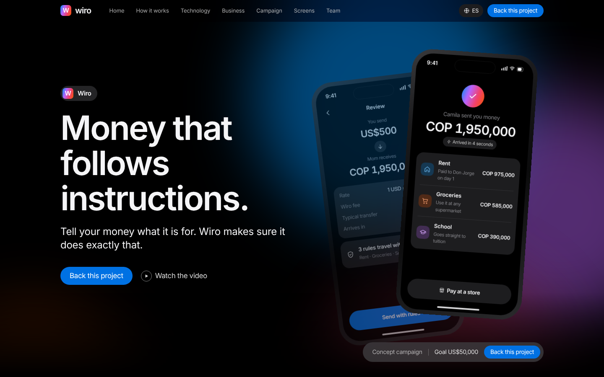
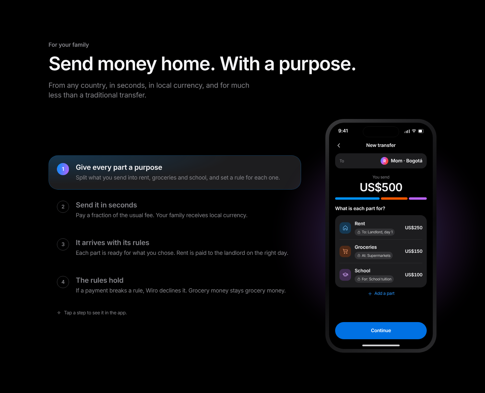
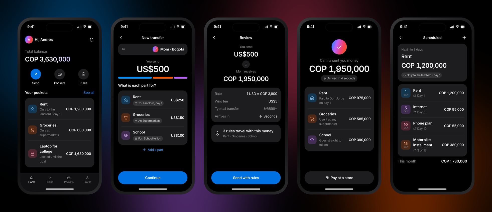

# Wiro

### Money that follows instructions.
**Dinero que sigue instrucciones.**

Tell your money what it is for. Wiro makes sure it does exactly that.

 

 

## The problem

Millions of people work abroad to support their families. In 2024 migrants sent around **US$685 billion** home to low and middle income countries, and a traditional transfer still costs **more than 6%** on average. Once the money arrives, the sender has no say over how it is used.

At home the same thing happens with our own money: we make a plan, and then willpower, forgotten payments and middlemen get in the way.

## The idea

**Wiro puts instructions inside your money.** You decide what every part is for, and the money follows those rules on its own.

<table>
<tr>
<td width="50%" valign="top">

### For your family, in any country
Send money home and say what each part is for. Rent goes only to the landlord, groceries only to supermarkets, and school straight to tuition. It arrives in seconds, in local currency, for much less than a traditional transfer.

</td>
<td width="50%" valign="top">

### For you, every day
- **Payments that make themselves:** rent, utilities and installments, on the right day.
- **Pockets with a purpose:** money that can only be used for what you defined.
- **Savings that wait for you:** unlocked only when you reach your goal.
- **Pay when it arrives:** online purchases paid only on delivery.

</td>
</tr>
</table>

 

 

## The app

Nine screens tell the whole story, in English and Spanish:

| Family transfers | Personal finance |
| --- | --- |
| **Set the rules** for each part of a transfer | **Home** with balance and pockets |
| **Review and send** with a fraction of the usual fee | **Pockets** that can only be spent on their purpose |
| **Money received**, already split and ready | **Savings goal** that stays locked until it is reached |
| **Rule in action**, when a payment breaks a rule | **Pay on delivery**, released when the product arrives |
| | **Scheduled payments** that run on their own |

## The technology

Wiro is built on **programmable money**: digital money, represented as a token on a distributed ledger, that carries software rules (smart contracts) about **when**, **to whom**, **how much** and **for what** it can be spent. The money and its rules travel together and cannot be separated.

Gartner added programmable money to its *Hype Cycle for Emerging Technologies* in 2025, in the innovation trigger phase, with 5 to 10 years to reach mainstream adoption.

| Layer | Role |
| --- | --- |
| Apps and people | Wiro, families, merchants and AI agents |
| Smart contracts | The rules: when, to whom, how much, what for |
| Token | Stablecoin, tokenized deposit or CBDC |
| Distributed ledger | Shared record of balances and payments |

## Who it is for

- **Families across borders:** migrants who send money home, and the parents, grandparents, children and students who receive it.
- **Everyday people:** anyone with a phone who wants to organize payments and savings, especially young people, freelancers and families.
- **Landlords and merchants:** supermarkets, pharmacies, schools, universities, online stores and utilities that get paid through Wiro and gain loyal customers.

## Business model

| | |
| --- | --- |
| **Transfer fee** | A fee on each international transfer, lower than traditional money transfer companies. |
| **Free and Premium** | Free for personal use. Premium adds more rules, more pockets and unlimited scheduled payments. |
| **Merchant fee** | A small fee paid by partner merchants on each purchase made with Wiro. |
| **Launch funding** | Venture capital and partnerships with banks and digital money issuers in the largest remittance corridors: US to Latin America, Europe to Africa and the Gulf to Asia. |

## Roadmap

1. **Pilot:** family transfers with rules between the United States and Colombia.
2. **Personal finance:** pockets, savings goals, scheduled payments and pay on delivery for everyone.
3. **Partner network:** supermarkets, pharmacies, schools and online stores join as merchants.
4. **New corridors:** Europe to Africa and the Gulf to Asia.

## Built with

A bilingual site with seven pages and interactive app mockups built in plain HTML and CSS: no images of the app, every screen is live.

## Team

**Group 6** · Research in Technology and Engineering · Universidad El Bosque, Bogotá, Colombia

| | |
| --- | --- |
| Santiago Pinzón Vásquez | 

 

Wiro is an academic prototype. It is not a financial product and does not collect money.

